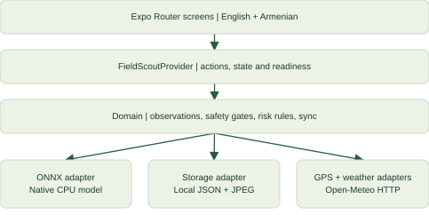
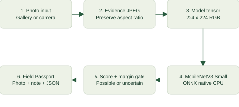
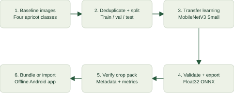
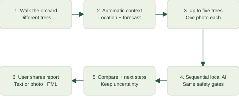
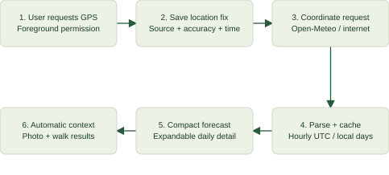

# Berqo: Technical Architecture

Apricot Field Scout | Standalone hackathon MVP | Android-first React Native

Maintained source document for technical reviewers and NotebookLM. Updated: 4 October 2026, Asia/Yerevan. Application version: 1.0.5. Bundled crop-pack version: 0.1.0. The uploaded Berqo bird-and-apricot logo is used unchanged in the launcher and application header.

## 1. Product and delivered scope

Berqo helps an apricot grower inspect a photo, understand a possible visible problem, preserve evidence in a Field Passport, and consider weather-based inspection reminders. The mobile app operates without an account or a private Berqo service. Core photo classification and saved records work offline. English and Armenian interfaces are included.

The farmer can upload an existing photo or optionally take one, run local AI, add a note, save a Passport, reopen it later, and share the photo or Passport JSON with an expert. Phone location supplies coordinates for a real weather forecast. A manual orchard location remains available for people away from the orchard or without location permission.

Version 1.0.5 adds a standalone Guided Inspection collection, a weather-to-inspection entry button, and readable reports. The original single-photo inspection, analysis, saving and reopening workflow remains available independently. Guided inspections use the same classifier without additional training or dependencies. Collections can be started without weather, from the dedicated collection list, or from a weather reminder.

This is a research MVP with four supported image classes: healthy, brown rot, shot hole on leaves, and shot hole on fruit. A prediction is presented as a possible finding, not a definitive diagnosis. The app does not identify every apricot disorder. It does not prescribe pesticide products, dosages, or an automatic irrigation volume.

## 2. System architecture

The application has four internal layers. Expo Router screens provide the interface. FieldScoutProvider coordinates user actions, model readiness, connection status, location, photos, records, and forecasts. The domain layer defines observation types, model contracts, confidence decisions, forecast parsing, risk rules, and synchronization behavior. Platform adapters implement the interfaces using native inference, local files, phone location, a public weather API, and a demonstration sync transport.

Only the weather path calls a remote operational API. It sends selected coordinates to Open-Meteo and receives forecast data. Photo classification runs inside the Android process using ONNX Runtime on the CPU. Photos and notes are not uploaded for inference. Sharing uses the operating system share sheet and a recipient selected by the user.

The MVP does not need a backend, login, database server, cloud inference endpoint, or AI API key. EAS is used during development to build and sign the Android APK; it is not a runtime dependency for photo classification.

## 3. Technology and source organization

The mobile stack is Expo SDK 57, React Native 0.86.3, React 19.2.3, TypeScript, and Expo Router. ONNX Runtime React Native 1.24.3 supplies native model execution. Expo modules supply photo selection, camera permission, image manipulation, files, document picking, sharing, network status, and foreground location. Small JavaScript libraries decode JPEG and base64 data. Python, PyTorch, torchvision, Pillow, NumPy, ONNX, and ONNX Runtime form the training/export pipeline; these training dependencies are not installed inside the mobile app.

- src/app/: route wrappers and navigation layout for home, inspection, result, history, settings, and a saved Passport.
- src/fieldScout/ui/: shared screens and action/state coordination.
- src/fieldScout/domain.ts: typed observations and replaceable service contracts.
- src/fieldScout/inspection.ts and report.ts: bounded collection updates, evidence summaries, forecast snapshots and safe readable report generation.
- src/fieldScout/safety.ts and ml/preprocess.ts: score decisions and image tensor creation.
- src/fieldScout/forecast.ts, risk.ts, and data/: forecast validation and bilingual advice.
- src/fieldScout/adapters/: ONNX classifier, file storage, phone location, weather HTTP client, and demo sync.
- assets/models/: bundled model, model metadata, and evaluation metrics.
- ml/: dataset preparation, training, export verification, and a Colab notebook.
- plugins/ and scripts/: native compatibility configuration, build and artifact verification, and document regeneration.

FieldScout is the internal module name. The installed application display name is Berqo. Keeping the Android package com.berqo.fieldscout lets the new branded APK update the existing app and retain its local records when signed with the same key.

## 4. Photo-to-observation pipeline

The gallery is the primary input path; a camera is optional. The selected image is converted to JPEG. For the saved evidence, the app preserves the aspect ratio and limits large images to a maximum dimension of 1,600 pixels. Model preprocessing is separate: it resizes to 224 by 224 pixels, decodes bounded RGB data, and produces a planar Float32 tensor of shape [1, 3, 224, 224]. The model resize stretches the image to a square; it does not preserve aspect ratio at inference input.

Each color channel is normalized using (pixel / 255 - mean) / standard deviation. RGB means are 0.485, 0.456, and 0.406; standard deviations are 0.229, 0.224, and 0.225. A simple luminance/variance gate rejects very dark, very bright, and featureless inputs. It is not a complete blur or image-quality detector.

The native ONNX session uses the CPU execution provider. Input tensor name is image; output tensor name is logits. Numerically stable softmax ranks the output. A possible finding requires a supported class, a finite score of at least 0.80, and at least 0.15 difference between the highest and second-highest scores. Otherwise the result is uncertain. Missing native support or a missing model is explicitly reported; the app never substitutes a fake prediction.

Confidence is a model score, not a calibrated probability that a diagnosis is correct. The gate cannot reliably reject all unrelated objects. The farmer is instructed to use apricot leaves or fruit and obtain expert confirmation.

## 5. Training, export, and measured evidence

The source dataset is AgriVision-Apricot, Bilal Jan, version 1, published on Mendeley Data under CC BY 4.0. The MVP uses original baseline images for four selected classes. Supplied augmented images are excluded. Dataset preparation checks labels, rejects conflicting duplicate labels, and removes exact decoded-image duplicates and identical difference-hash duplicates before splitting. This is not comprehensive near-duplicate or orchard-group leakage prevention.

The prepared split has 356 training images, 78 validation images, and 78 test images. Each class is split deterministically with seed 42 and approximately 15 percent each for validation and test. Similar scenes from the same tree may remain across splits. These figures describe the bundled run, not the full dataset archive.

Training starts from ImageNet-pretrained MobileNetV3 Small. The classifier is replaced with four outputs. The feature backbone is initially frozen; the final three feature blocks can be fine-tuned in the configured final training epochs. AdamW and class-weighted cross entropy address the small, imbalanced dataset. Training augmentation includes horizontal flips, small rotations, and modest color jitter. The best checkpoint is selected using validation macro-F1. Temperature scaling and the confidence threshold are selected from validation data, not from the test set; the bundled model's fitted temperature is 1.0.

The selected model is exported as float32 ONNX with opset 17. The pipeline checks the ONNX graph and compares exported outputs with PyTorch. The bundled crop pack is 6,098,545 bytes, approximately 6.1 MB. Quantization is deferred until accuracy and device behavior are measured. No further training or Colab account is required to install and use the submitted APK.

On the 78 held-out test images, the bundled model achieved 85.90 percent accuracy and 87.43 percent macro-F1. Per-class F1 was 81.48 percent for healthy, 92.31 percent for brown rot, 97.67 percent for shot-hole leaves, and 78.26 percent for shot-hole fruit. Test class counts were 24, 7, 21, and 26 respectively. These small sample sizes and the random image split limit the conclusion. They are not evidence of equivalent performance in Armenian orchards.

The separate supplied Colab pack was checked locally on the same held-out images: 85.90 percent accuracy and 87.60 percent macro-F1. It is staged as 0.1.1-colab and is not the default bundled pack. This slightly higher macro-F1 does not establish a meaningful improvement. Model import validates metadata and a candidate native session before switching the active model descriptor.

## 6. Field Passports and offline persistence

Each FieldObservation has schemaVersion 1, a locally generated ID, crop, creation time, persistent image URI, optional location, optional model prediction, decision, farmer note, advisory ID, review status, and sync status. Predictions include model ID, version, confidence, top-two margin, and elapsed preprocessing-plus-inference time. Location can include latitude, longitude, reported accuracy, source, and the time the location fix was obtained.

The FileObservationRepository stores one JSON file per observation, with a separate persistent JPEG. Preferences, forecasts, and the active imported model descriptor are also JSON files under the app's document directory. Writes are serialized and staged through a temporary file before moving it to the destination. This is a lightweight file store, not SQLite. No application-level encryption, cloud backup, or cross-device replication is implemented.

Classification and photo recording require no network. Saved records survive app closing and reopening. An APK update with the same package and signing key retains app data. Uninstalling or clearing app data deletes local records, so important evidence should be exported first. JSON export omits the private local image URI and refers to a separately shared photo file. Notes and coordinates are included in a shared Passport.

The recorded coordinates are the selected orchard location at analysis time. They are not extracted from the uploaded photo's EXIF and should not be described as proof of where or when the photograph was taken. Guided collections freeze the selected orchard location at collection creation; moving or changing Settings does not silently relabel earlier samples.

OrchardInspection is a separate schemaVersion 1 record with an ID, creation timestamp, selected orchard location, in-progress/complete status, optional note, observation array and optional forecast snapshot/reason. The app stores all collections in inspections.json, separate from the existing observations directory. Each successfully added tree receives a persistent JPEG and the unchanged safety decision. Single-photo drafts, notes and Passports are not consumed by collection actions. A rejected quality check leaves the pending collection photo available for replacement and does not add a tree.

Users choose one photo for each of up to five different trees, analyze sequentially, remove the last entry for a retake, and finish after one to five samples. Added entries are saved immediately and incomplete collections can be resumed after restart. Inspection notes need the explicit save-note button or Finish; an unanalysed selected photo is an in-memory draft. Finished collections are read-only. Removed entries leave their JPEG in the local photo directory; automatic cleanup and collection deletion are future work.

The summary counts photos with possible supported symptoms, photos with no obvious supported symptoms, and inconclusive/unavailable photos. Low-confidence healthy-looking predictions remain inconclusive. Five is a guided starting point, not a validated sampling protocol. The app does not calculate orchard infection prevalence, declare trees healthy, aggregate scores into a disease probability, or assign an unvalidated low/medium/high orchard risk. Distinct-tree selection is a user instruction, not automatically verified.

## 7. Phone GPS, forecast, and suggestions

The user taps Use phone GPS & get forecast. The PhoneLocation adapter asks for foreground location permission, checks that phone location services are enabled, and requests a high-accuracy current fix. A 25-second UI timeout prevents indefinite waiting. Permission denial, disabled services, and a timeout have actionable bilingual messages. The app does not subscribe to continuous tracking or request background location permission.

The location source, coordinates, timestamp, and reported accuracy are shown to the farmer and saved locally. Changing coordinates discards the previous location's forecast. If the phone is offline, coordinates can still be saved when a location fix is available; the forecast can be refreshed after reconnecting. Manual entry remains a fallback. The default Armavir coordinates are identified as a default on a new installation.

OpenMeteoWeather requests three forecast days, hourly temperature, relative humidity and precipitation, plus daily minimum/maximum temperature and precipitation totals. The request uses timezone=auto and timeformat=unixtime. Hourly timestamps are stored as UTC instants. Daily dates use the returned UTC offset, avoiding an Armenian midnight being labeled as the previous UTC date. The parser rejects missing/non-finite readings rather than treating them as zero rain. The HTTP request has a 12-second abort timeout.

The interface shows six upcoming hourly readings, a next-48-hour temperature range and precipitation sum, and three daily summaries in the forecast's timezone. Forecast data is downloaded once and cached. A cache older than 24 hours produces a stale warning and suppresses suggestions. A visibly marked sample-weather option is available for demonstrations and does not overwrite the saved real forecast.

Suggestions are transparent rules over future forecast hours, separate from photo classification. Below-zero temperatures prompt checking local conditions and growth stage with an agronomist. Any forecast precipitation prompts inspecting leaves and fruit after wet conditions. When at least 24 future hourly readings are available and none predict precipitation, the app suggests checking root-zone soil moisture before adjusting irrigation, especially for young trees. The rules cover the available next 48 hours. Rainfall alone is not a leaf-wetness measurement or a disease forecast; a dry forecast alone does not measure irrigation needs. Advice links to UC IPM sources.

Weather cards now offer Start a weather-informed inspection. Each reminder can pass its bilingual explanation to the new standalone collection. At creation, a forecast is copied only if coordinates match, its download age is zero to 24 hours and it contains future readings. Missing, wrong-location, future-dated, exhausted and stale forecasts are omitted. Demo snapshots remain explicitly marked. A stored snapshot is historical forecast evidence, not observed weather or a continuously refreshed risk estimate; later forecasts do not rewrite it.

## 8. Sync, sharing, and data boundaries

ObservationSync works through a SyncAdapter. The current LocalDemoSync adapter simulates delivery and saves a local receipt. It sends nothing to an agronomist or a server. A failed queued record retains its error and can be retried. A successful demonstration receipt changes sync status but does not mark expert review submitted. Only a real adapter response explicitly accepting review may change review status to submitted.

Manual operating-system sharing is real: the user can send Passport JSON and a photo to a recipient they choose. This differs from the simulated expert queue. The app does not contain authentication, push notifications, an agronomist portal, analytics collection, or a production expert-review API.

Readable report actions are available on both a saved single-photo Passport and a guided collection. The on-screen preview includes sample counts, dated individual findings, model scores and versions, notes, limitations and any collection forecast snapshot. Coordinates are excluded by default and require an explicit switch for each report screen. Existing JSON export still includes its previously documented coordinates; the new privacy switch applies to the readable report only.

Share text summary uses React Native Share to open the system text-sharing menu without photos. Share readable report with photos produces a self-contained HTML file and opens Expo Sharing. Each evidence photo is reduced to a 480-pixel-wide JPEG thumbnail, embedded as base64 and captioned by tree index. Notes and text are HTML-escaped, base64 values are validated and no scripts, remote image requests or private file URIs are included. Recipients open the HTML attachment in a browser; compatibility with particular messenger/browser combinations still requires manual verification. HTML was chosen to avoid a new PDF-generation native dependency. The report does not claim delivery or expert review based on opening the share menu. Export files stay locally under exports until app data is cleared; there is no automatic retention policy.

Personal photos, notes, and coordinates are not part of the source-code distribution. Dataset ZIPs, trained checkpoints, local tool downloads, temporary device snapshots, secrets, and build outputs are excluded from EAS upload or version-control distribution as configured. The bundled model and license attribution are included. The public Open-Meteo endpoint is used for the non-commercial hackathon; commercial deployment requires reviewing provider terms and choosing an appropriate service plan.

## 9. Integrating into the existing Berqo product

The migration path is to reuse the fieldScout domain and adapters inside the existing product rather than rewrite the feature. CropClassifier exposes initialize and classify. ObservationRepository exposes list and save. LocationProvider exposes current. WeatherService exposes refresh and cached. SyncAdapter exposes send and a receipt/review-acceptance response. Their TypeScript contracts live in domain.ts.

For a future React Native Berqo app, host the screens/provider inside its navigation, inject the existing identity and orchard context, and replace FileObservationRepository with its persisted store and migrations. Replace LocalDemoSync with an authenticated Berqo API adapter; add idempotent observation IDs, upload acknowledgements, retry/backoff, photo upload and real review status. These are future steps, not delivered server features.

For an existing Flutter or other mobile client, the crop pack and JSON observation schema can be reused, but React Native screens cannot simply be embedded without a separate integration strategy. A native implementation of preprocessing and inference must match the model's normalization, layout, class order, and confidence policy and be validated on that runtime. The contracts describe the boundary; integration into the existing Berqo product has not yet been performed.

Before production use, gather independent orchard/tree/date-grouped images, evaluate all supported classes and unknown inputs, calibrate confidence, validate device preprocessing and speed across phones, and establish an agronomist-reviewed advice/update process. Add access controls, appropriate data protection and retention, reviewed model provenance, and actual expert workflow only when the product requires them.

## 10. Build and verification

EAS builds and signs an installable Android preview APK. The preview profile targets arm64-v8a to reduce size for modern Android phones, including the tested Galaxy S25. It is not a universal APK for every Android architecture. The production profile is configured separately; the hackathon APK is not a Play Store publication. iOS has not been built or physically validated.

Native behavior is controlled by app.json and an isolated config plugin. The plugin pins the ONNX Android runtime dependency and adapts obsolete Gradle version handling. It also configures ARM64 native-library 16 KB alignment. Explicit React Native autolinking registers OnnxruntimePackage; a startup guard reports unavailable native support instead of importing a missing JSI binding. Generated Android/iOS folders are excluded from EAS upload, so cloud prebuild regenerates them.

Artifact verification checks the APK signature, ZIP integrity, exact bundled model/metadata hashes, standalone JavaScript bundle, ARM64 ONNX libraries, and native ELF/ZIP alignment. These alignment checks do not substitute for testing a real 16 KB-page device. The tested Galaxy S25 has 4 KB pages.

Type checking and lint pass for the branding change. The preceding behavior update passed all 15 application tests and all 21 Expo Doctor checks. Tests cover score gating, stable softmax, preprocessing, bilingual completeness, persistence contracts, retry/demo-review semantics, forecast parsing, local dates, stale forecasts, weather suggestions, and cache/location matching. Dataset-pipeline tests also exist.

Version 1.0.5 passes typecheck, lint, native ONNX autolinking and all 20 application tests. Five new tests cover uncertainty-preserving counts, collection limits/immutability, forecast snapshot validity, coordinate privacy/bilingual report content, and escaped self-contained HTML. Existing single-photo inference and saving actions retain their behavior. New collection and report phone acceptance tests are pending until the new APK is installed; automated tests do not prove a messenger received the attachment.

Physical evidence before the branding-only update: version 1.0.2 passed user-confirmed offline photo classification and Passport save/reopen. Version 1.0.3 installed and launched without app-scoped startup errors; native UI inspection confirmed a real phone-location fix, reported accuracy of 33 metres, and a freshly downloaded forecast in Asia/Yerevan. The new forecast cache/reopen test still awaits user confirmation. One saved observation displayed 112 ms preprocessing plus inference; that is a single sample, not a benchmark or a guaranteed latency.

The branded version 1.0.4 / versionCode 5 completed EAS build c4cdb281-19e6-44fe-bc21-a0f311e43ea1. Its 75,177,401-byte APK passed v2 signature verification, bundled model/metadata hash checks and ARM64 alignment checks. The Android manifest label is Berqo. This release changes branding, while retaining the preceding model and app behavior. It installed successfully on the same Galaxy S25 and launched with no app-scoped startup error. The jury-pack script checks release metadata and the verified APK hash before assembling the handoff.

Version 1.0.5 / versionCode 6 completed EAS build 3fc87a87-21ef-424a-b67f-ba18b506b560. The 75,202,189-byte APK passed v2 signature verification, model/metadata hash checks, standalone-bundle checks and ARM64 alignment checks. SHA-256: 1019e7b26f28a75f342928ba28637b465b9454f990d0d01edacddd763c6ada5c. It retains package com.berqo.fieldscout and the same signing key. The USB installation attempt timed out while a Play Protect dialog was open; the phone still reports 1.0.4. The new APK is copied to Downloads/Berqo-1.0.5.apk for user installation. New collection/report phone acceptance is pending. Prior release files are retained locally. The current download link and retention deadline live in docs/JURY_SHARE.md and README; the QR generator reads current release metadata to avoid a stale link.

## 11. Jury distribution and demonstration

Distribute the latest signed APK using its EAS download link or a shared file. The jury needs a compatible Android phone and installation permission for the app used to open the APK. Expo Go, a developer account, a model download, and an API key are not required. The model is bundled. Do not uninstall an older Berqo build to update it; install the newer APK over it to retain Passports.

For a short demonstration, install the APK, obtain a forecast online at the orchard or use clearly labeled sample weather, then switch to airplane mode. Upload an apricot photo, analyze it, inspect the possible/uncertain finding, add a note, save a Passport, close/reopen, and show the persisted record. Reconnect to demonstrate GPS and the live forecast. Explain that expert sync is a local demonstration and manual sharing is the available real route to an expert.

Then show the independent Guided inspections screen or weather entry button, add photos representing different trees, explain the sampled-photo counts, finish and reopen the collection. Open the readable report preview, show that coordinates are opt-in, and open then cancel native sharing during the demonstration. Actual sample photos used in a video should be labeled as demonstration evidence; reused dataset photos do not constitute a real orchard visit. The report's HTML can be opened locally in a browser and its text summary sent through an installed messaging app by the farmer.

Give the jury the APK link, this PDF, the dataset/license reference, a short real screen recording, and source code if the challenge requires it. A technical explainer generated by NotebookLM complements a real phone demonstration; it does not prove app behavior. Keep a local APK copy because hosted artifact retention can be limited. iPhone-only jurors can watch the demo video or use your Android demonstration device; a working iOS build is not part of this delivery.

## 12. Suggested technical video narrative

Scene 1 - Problem and scope: An apricot grower needs an inspection assistant in a place with unreliable internet. Introduce Berqo and its four supported photo classes, then show the farmer uploading a photo.

Scene 2 - Architecture: Use the system diagram to explain screens, orchestration, domain logic, and replaceable adapters. Contrast the local photo-data path with the coordinate-only weather request. Do not depict a cloud AI service for the current app.

Scene 3 - Small AI: Walk through JPEG preparation, a 224-square RGB tensor, MobileNetV3 Small, native CPU inference, softmax and uncertainty gating. Show the 6.1 MB model figure. State that the model score is not a diagnosis.

Scene 4 - Training evidence: Show baseline images, deduplication before splitting, transfer learning, validation and ONNX export. Quote 85.90 percent accuracy and 87.43 percent macro-F1 on 78 test images, with the random-split and local-orchard limitations visibly stated.

Scene 5 - Evidence and weather: Explain persistent photo/JSON Passports, explicit model versions, phone location provenance, live three-day forecasts, offline caching, and basic frost/rain/soil-moisture suggestions. Do not imply continuous GPS tracking.

Scene 6 - Honest integration path: Show the replaceable interfaces and future authenticated Berqo backend. Clearly label the existing sync transport as a local demo. Close with the Android APK demonstration and independent validation needed before production.

## 13. Sources and maintenance

Implementation sources: src/fieldScout/domain.ts, ui/Provider.tsx, ui/Screen.tsx, adapters/classifier.ts, adapters/storage.ts, adapters/location.ts, adapters/weather.ts, forecast.ts, risk.ts, safety.ts, sync.ts; ml/prepare_dataset.py and ml/train.py; assets/models/metadata.txt and metrics.json; app.json, eas.json, plugins/withOnnxGradleCompat.js; docs/VALIDATION.md.

External references:

- AgriVision-Apricot dataset/license: https://data.mendeley.com/datasets/5wk5wpzczw/1
- Expo SDK 57: https://docs.expo.dev/versions/v57.0.0/
- Expo app configuration: https://docs.expo.dev/versions/v57.0.0/config/app/
- Expo internal distribution: https://docs.expo.dev/build/internal-distribution/
- ONNX Runtime React Native: https://onnxruntime.ai/docs/get-started/with-javascript/react-native.html
- Open-Meteo forecast contract: https://open-meteo.com/en/docs
- UC IPM apricot cultural care: https://ipm.ucanr.edu/home-and-landscape/cultural-tips-for-growing-apricot/
- UC IPM apricot disease inspection: https://ipm.ucanr.edu/PMG/C005/m005fpdiseases.html
- NotebookLM source types: https://support.google.com/gemininotebook/answer/16215270
- NotebookLM video generation: https://support.google.com/gemininotebook/answer/16454555

Maintenance: update this source when behavior, architecture, models, validation evidence, privacy/data movement, dependencies, deployment, or integration boundaries change. Update diagram definitions in scripts/export-architecture.py when flows change, regenerate the PDF and SVGs, and visually check the output. Preserve the distinction between implemented, measured, pending, demonstration, and future work. Repository instructions make this part of subsequent changes. Uploaded NotebookLM files are snapshots: replace/re-upload the source after an update.
